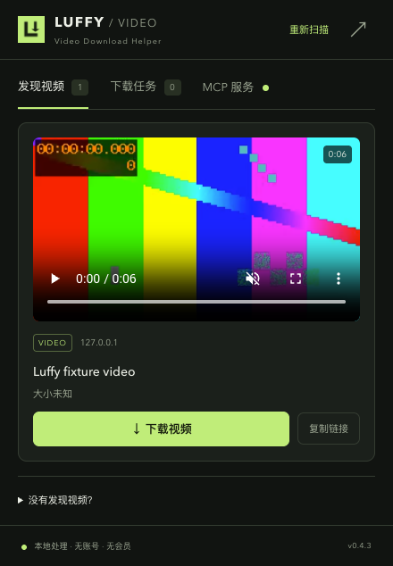
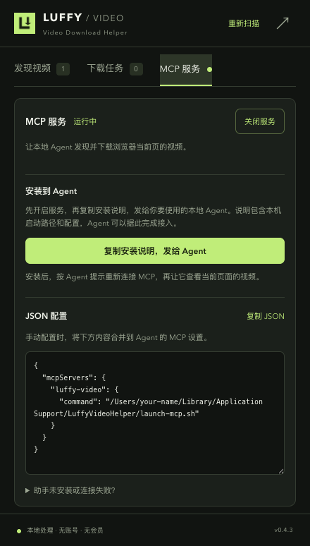

# Luffy Video Download Helper

[中文](README.md) · **English**

A local-first video downloader for Chrome and Edge. Discover videos on the current page, preview and download them, or let a local Agent use the same workflow through MCP.

No account, subscription, or remote activation. Media processing runs on your computer. The extension UI is currently in Chinese.

<p>
  
  
</p>

*Screenshots use synthetic local media. The MCP status and username path are illustrative; no personal browsing history or machine configuration is included.*

## Features

- **Discovery and preview:** detect MP4 / WebM, HLS and DASH; display covers, previews and download options.
- **HLS downloads:** choose quality and audio; merge TS / fMP4 segments, including byte ranges and ordinary AES-128 encryption.
- **YouTube / X:** recognize video detail pages and resolve them with local yt-dlp; select quality and MP4 / MKV / original output.
- **Job management:** track progress, cancel downloads and reveal saved files. Closing the popup does not stop downloads.
- **Local MCP:** let an Agent inspect the active page, select a video, download it and check the result.

| Content | Download route |
| --- | --- |
| Direct MP4 / WebM | Browser download manager; original format |
| HLS video on demand | Browser merge to MP4, or native helper |
| YouTube / X video detail pages | Local yt-dlp + FFmpeg |
| DASH | Detected and routed to the native helper; no dedicated acceptance test yet |
| DRM / SAMPLE-AES / live streams | Not supported |

Browser HLS input is limited to **256 MiB**, with one merge job at a time. The native helper handles up to two concurrent jobs. Login, regional restrictions, expiring signatures and anti-automation measures can affect availability; compatibility with every website is not guaranteed.

## Installation

**Install directly:** visit the [product page and installation guide](https://luffyliu.com/en/luffy-video-download-helper/), download the prebuilt ZIP, extract it and use **Load unpacked** in your browser’s Developer mode. Select the **extension** folder and keep it in a permanent location. No build is required. Choose the named `Luffy-Video-Download-Helper-version.zip` asset, not GitHub’s automatic Source code archives.

Distribution currently uses manual ZIP installation, with no store install link. The extension’s upper-right arrow opens the product page. This repository contains source code; installation archives are available separately in [GitHub Releases](https://github.com/CarGod/luffy-video-download-helper/releases). Source-build instructions follow.

### 1. Build the extension

Requires Node.js 20+ and npm.

```sh
git clone https://github.com/CarGod/luffy-video-download-helper.git
cd luffy-video-download-helper
npm ci
npm run build
```

Open `chrome://extensions` in Chrome or `edge://extensions` in Edge:

1. Enable **Developer mode**.
2. Choose **Load unpacked** and select the project's **dist** folder.
3. Pin Luffy to the toolbar. Play a video on a website, then open Luffy.

After editing the source, run `npm run build` and reload the extension.

### 2. Install the native helper (required for YouTube / X / MCP)

The installer currently supports **macOS only**. It requires Python 3.10+, Node.js and FFmpeg, including ffprobe. Direct browser downloads and browser-based HLS do not require the helper.

```sh
# If needed, install prerequisites using Homebrew:
brew install python node ffmpeg

# From the project directory:
python3 native/install.py
```

Alternatively, double-click `Install-Luffy-Helper.command`. The installer creates an isolated Python environment, installs yt-dlp and the MCP SDK, and registers a Native Messaging host for Chrome, Edge and Chromium. Initial installation downloads dependencies from the internet.

Reload the extension after installation. If an updated helper still reports an old-version error, restart the browser. Native downloads default to `~/Downloads/Luffy/`; browser downloads follow browser settings.

**Keep the public key in the manifest:** it fixes the extension ID used by the native host allowlist. It is public identity material, not a private key.

## Connect a local Agent with MCP

1. Open the extension's **MCP 服务** (MCP service) tab and select **开启服务** (enable).
2. Click **复制安装说明，发给 Agent** (copy setup instructions for an Agent), then send the text to your local Agent. It includes the actual launcher path, configuration and verification steps.
3. Reconnect or restart the client as instructed. For manual setup, use **复制 JSON** (copy JSON) beside the always-visible configuration box.

The tab's status dot is **green** when running, **gray** when off, and **red** on error. MCP is off by default; the switch is remembered. Disabling it removes the local bridge endpoint while existing downloads continue.

Example configuration (`your-name` is a placeholder; use the configuration generated by the extension):

```json
{
  "mcpServers": {
    "luffy-video": {
      "command": "/Users/your-name/Library/Application Support/LuffyVideoHelper/launch-mcp.sh"
    }
  }
}
```

Clients supporting stdio MCP can use this launcher. Configuration file formats differ between clients. The installer does not change existing Agent settings.

| Tool | Purpose |
| --- | --- |
| `list_connections` | List connected browser instances and active pages |
| `list_videos` | Scan the active page or an explicit `tab_id` |
| `inspect_video` | Inspect HLS quality and audio choices |
| `download_video` | Download a selected candidate; returns a job ID |
| `get_jobs` | Read progress, errors and saved file paths |
| `cancel_download` | Cancel a specific job |

When multiple videos are present, specify `media_id`. Downloads require the `tabId` and `page_url` returned by `list_videos`; requests for a changed page are rejected. Only `complete` means the file has been saved. After a timeout, check jobs before retrying. Closing the browser invalidates its connection; call `list_connections` again after reopening.

Try asking your Agent: **“Use Luffy to list videos on the current page, download the one I choose, and tell me where it was saved.”**

## Privacy and permissions

- No telemetry, account system or developer upload endpoint. Downloads and previews contact the media source directly; installation contacts PyPI.
- Website access and network observation permissions are used for discovery. Media URLs, necessary headers and job records live in browser session storage and are cleared when the browser exits. The MCP switch is stored separately.
- Browser cookies are not read by default. Local yt-dlp reads them only when a login source is explicitly selected.
- Header rules target exact resource URLs requested by the extension. Incognito pages are excluded.
- MCP uses stdio. The internal Unix socket bridge lives under `~/.luffy-video-helper/run/`, with directory mode 0700 and socket mode 0600. There is no TCP / HTTP listener. Programs running as the same operating-system user can access the enabled service.
- Connected Agents receive page titles, URLs and output paths. Use a trusted local client, and treat website text as data rather than instructions.

## Development and testing

```sh
npm test
python3 -m unittest discover -s tests -p '*_test.py'
npm run build

# Browser integration test; install the native helper first for MCP tests
npx playwright install chromium
node scripts/mcp-integration.mjs
```

Set `LUFFY_CHROMIUM=/absolute/path/to/chromium` to select a test browser. Integration tests use temporary profiles and synthetic local media. See [validation notes](docs/VALIDATION.md) for coverage and limitations.

```sh
# Capture documentation screenshots with synthetic media
node scripts/docs-screenshots.mjs

# Build an archive for local use
npm run pack
```

| Path | Responsibility |
| --- | --- |
| `src/background.js` | Discovery, jobs and Native Messaging |
| `src/ui.js` / `public/` | Video list, previews and MCP UI |
| `src/hls.js` / `src/offscreen.js` | HLS processing and FFmpeg WASM merging |
| `src/mcp.js` | Browser operations exposed through MCP |
| `native/` | Native downloader, MCP server and installer |
| `scripts/` / `tests/` | Builds, screenshots and tests |

## Uninstall

Remove the browser extension, then optionally delete:

- `~/Library/Application Support/LuffyVideoHelper/`
- `com.luffy.video_helper.json` from each browser's `NativeMessagingHosts/` directory
- `~/.luffy-video-helper/`

Downloaded files remain in `~/Downloads/Luffy/`. Review them before deleting the directory.

## License

Original project source code is released under the [MIT License](LICENSE). Third-party components retain their own licenses; see [THIRD_PARTY_NOTICES.md](THIRD_PARTY_NOTICES.md). The FFmpeg WASM core includes GPL components. Distributing binaries containing that core requires addressing the corresponding-source and license obligations. The repository contains source and documentation; Releases distribute installation archives with source and build references in SOURCE.md.
